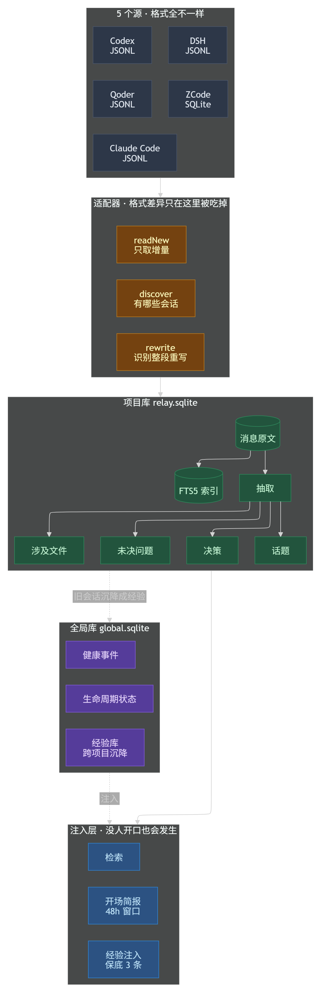
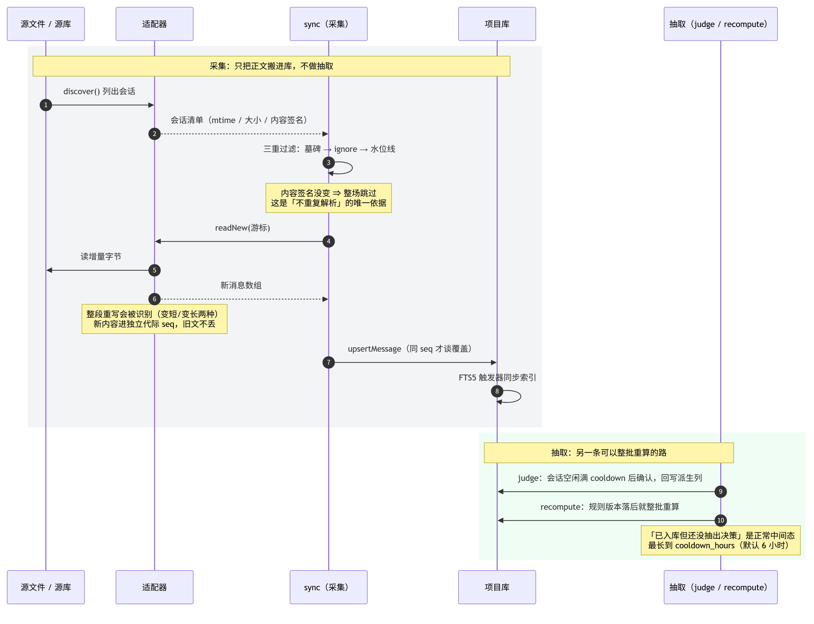
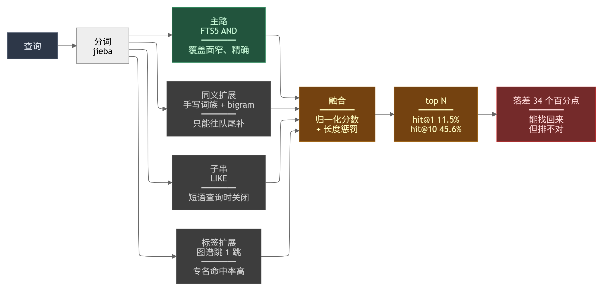
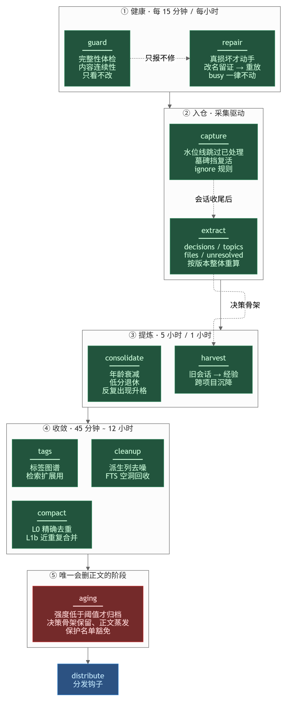
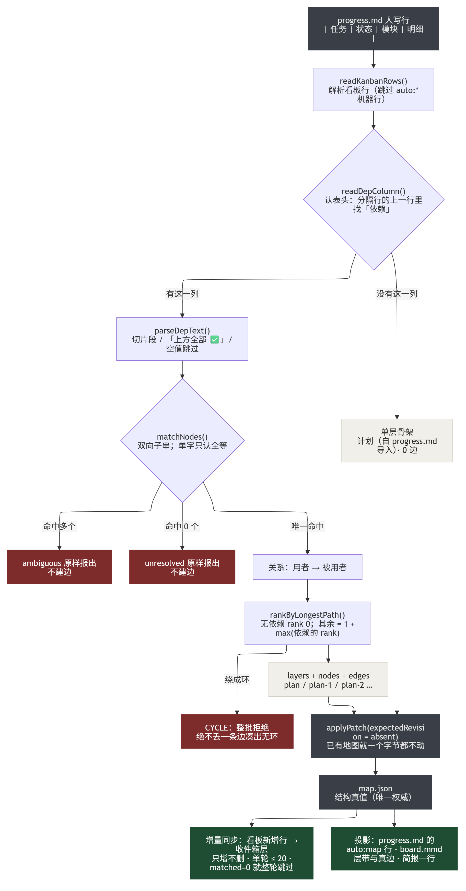

# memrelay（会话接力）

简体中文 | [English](./README.en.md)

> 仓库名 **memrelay** · memory + relay。CLI 命令仍是 `srelay`（历史原因，不折腾）。

[](https://github.com/rui08984-dot/memrelay/actions/workflows/ci.yml)


**把 AI 会话存成本地记忆库，让下一个会话开场就带着上一个会话的结论。**
属于项目，不属于任何厂商——数据在你自己的磁盘上，检索边界由你划定。

---

## 一、它是什么，不是什么

你和 AI 聊了三天，方案定了、坑踩过了、结论写在对话里。关掉窗口，这些就没了；换台机器、换个模型，更没了。

memrelay 干的事只有一件：**把这些对话在本地收下来，整理成可检索的结构，下一次开场自动带上最近发生的事。**

守护进程在你不用管的时候跑完整条链路：

```
采集（六个客户端） → 抽取（决策/话题/文件/未决） → 存储（SQLite + FTS5）
                                                      ↓
                        生命周期（11 个阶段，含归档与经验沉淀）
                                                      ↓
                          检索 / 简报 / 看板 / 地图 / 面板
```

**它不是这些**：

| 不是 | 区别 |
|---|---|
| 不是云端记忆服务 | 没有账号、没有服务器；两个 SQLite 文件就是全部状态 |
| 不是向量数据库 | 主路是 FTS5 + 中文分词 + 长度惩罚；语义检索是可选档，实测更慢且没涨召回（见 §五） |
| 不是聊天记录导出工具 | 导出只是副作用；核心价值是**抽取后的结构**（决策、未决、涉及文件）能主动注入下一次会话 |
| 不是通用知识库 | 一个项目一个库，永不合并；项目库能被 `forget` 整个删掉，跨项目经验不跟着消失（见 §十） |

---

## 二、快速开始

```bash
# 方式一：npm 安装（推荐）
npm install -g memrelay

# 方式二：零安装试用
npx memrelay init

# 方式三：从源码
git clone https://github.com/rui08984-dot/memrelay.git
cd memrelay && npm ci && npm run build && node dist/srelay.js init
```

```bash
cd <你的项目>
srelay init                       # 建 .sessionrelay/（只在本项目目录内）
srelay doctor                     # 体检：源目录、守护、库完整性、抽取规则版本
srelay watch --install-service    # 守护常驻（Windows Run 键 / launchd / systemd user）
srelay status                     # 会话数、消息数、各阶段最近一次结果
```

最短验证：`srelay brief` 打印「下一场会话开场会看到什么」。如果它是空的，说明还没采到东西。

---

## 三、它由哪些部分组成

每一块都有独立工程文档；这份 README 只讲分工和边界。

| 层 | 负责什么 | 不负责什么 | 文档 |
|---|---|---|---|
| **采集** `src/adapters/` `src/capture/` | 从六个客户端读会话、增量落库、失败可见 | 不做抽取、不改写原文 | [docs/CAPTURE.md](./docs/CAPTURE.md) |
| **抽取** `src/core/extract/` | 决策 / 话题 / 涉及文件 / 未决问题四件套；规则可整体重算 | 不读源文件（只读库里的正文） | [docs/EXTRACT.md](./docs/EXTRACT.md) |
| **存储** `src/store/` | 两个库的 schema、FTS5 索引、归档与重建 | 不做检索排序 | [docs/STORE.md](./docs/STORE.md) |
| **检索** `src/search-svc/` | 四路融合、长度惩罚、时间衰减、多库合并 | 不改数据 | [docs/SEARCH.md](./docs/SEARCH.md) |
| **生命周期** `src/core/lifecycle/` | 11 个阶段的节奏、熔断、健康事件 | 不是流水线（各阶段独立） | [docs/LIFECYCLE.md](./docs/LIFECYCLE.md) |
| **地图** `src/map/` `src/cli/map.ts` | 计划的结构真值：层、依赖边、状态、对账 | 不写 `progress.md` 的人写行 | [docs/MAP.md](./docs/MAP.md) |
| **接口面** `src/bin/` `src/mcp/` `src/panel/` `integrations/` | CLI、MCP Server、面板、客户端集成 | 不各自定义数据口径 | [docs/INTERFACES.md](./docs/INTERFACES.md) |

一条贯穿全仓的纪律：**判据只许有一份**。同一个判断在两处各写一遍，迟早会漂——这个项目里踩过太多次，
最近两次的代价分别是「工具白名单完整性校验静默失效」和「人的计划行被当成机器行删掉」。

---

## 四、数据怎么流动



*图源 [layered.mmd](./docs/diagrams/layered.mmd)*

**两个库是硬边界**：项目库（`.sessionrelay/*.sqlite`）只放这个项目的会话与派生数据；
全局库（`~/.sessionrelay/global.sqlite`）只放跨项目的东西——经验、生命周期状态、健康事件。
分开的理由很实际：项目库会被 `forget` 整个删掉，而跨项目经验不该跟着蒸发。

一次会话进来时发生什么：



*图源 [session-flow.mmd](./docs/diagrams/session-flow.mmd)*

三个不显然的决定：

- **用内容签名判断"变没变"，不看修改时间**。修改时间会被备份工具、文件同步、甚至读操作碰一下。
- **整段重写单开一代 seq**（`seq = 代数 × 1e6 + 行号`）。源文件被重写后行号会重排，直接覆盖等于用新内容盖掉旧正文，而且不报错。
- **抽取不写在采集里**。抽取规则会变（现在是 v26），改规则要能整批重算，而不是重新读一遍源文件。

---

## 五、检索：能找回来，但排不对

一次查询同时走四条路，按归一化分数融合后排序：



*图源 [retrieval.mmd](./docs/diagrams/retrieval.mmd)*

305 道题、105 个会话的实测（题集与逐格数字见 [docs/EVALUATION.md](./docs/EVALUATION.md) 与 [数据表](./docs/eval/memrelay-eval.xlsx)）：

| 指标 | 实测 | 含义 |
|---|---|---|
| **hit@1** | **11.5%** | 第一下就找对的比例 |
| **hit@10** | **45.6%** | 前十里有正确答案的比例 |
| 簇级 95% CI | ±3.85pt | 按会话整簇重采样，不是按题重采样 |

两者差 34 个百分点，说明**能找回来，但排不对**——主路是会话级 AND，查询词多一个候选就少一截；
另外三条路权重都低于主路，只能往队尾补。

**试过、没用、已关的**（写在这里是为了让下一个人不必从头再试）：

| 机制 | 结果 |
|---|---|
| 同义词族扩展（补 8 组词） | 几乎无变化；换说法题救回 3、打掉 0，字面题零回归 |
| 剔问句外壳重搜 | hit@1 反而差 0.3pt、延迟 +12.6%（配对比较 p=1.00 不显著）；默认关 |
| 纯 RRF 融合 | 只看名次白算分数、长度惩罚进不去路内；已回滚 |
| 语义检索（向量档） | 召回 40% vs 45%（n=80，在噪声内），延迟 2.15 倍；默认关，向量数据保留 |

真正的瓶颈在**查询侧**：把「上次那个库一直涨的事」拆成能命中正文的词，比继续调 BM25 参数有用。
这一条目前只做到很浅的程度，是后续的主要方向。

### 语义检索（可选）

默认关是**实测结论，不是没做**。想自己验一遍：

```bash
srelay semantic --enable   # 装依赖 + 下载模型 + 存量回填
srelay semantic --test "换一种说法的查询"   # 对比：纯字面 vs 字面+语义 的命中差异
srelay semantic --status   # 向量数 / 待嵌积压 / 模型状态
srelay semantic --disable  # 关回去（向量保留，检索立刻回退纯字面）
```

---

## 六、生命周期：11 个阶段

守护进程按各自的节奏跑 11 个阶段。不是流水线，是各自独立的定时任务——一个失败不该拖垮别的。



*图源 [lifecycle.mmd](./docs/diagrams/lifecycle.mmd)*

| 阶段 | 干什么 | 默认节奏 | 会改数据吗 |
|---|---|---|---|
| `guard` | 体检与自检（库完整性、心跳） | 15 分钟 | 否 |
| `repair` | 损坏自愈（从原始会话重放） | 60 分钟 | 是 |
| `capture` | 采集客户端会话 | 15 分钟 | 是 |
| `extract` | 抽取 / 按规则版本重算 | 30 分钟 | 是 |
| `harvest` | 经验采集（跨项目沉降草稿） | 6 小时 | 是 |
| `consolidate` | 经验衰减 / 退休 / 冲突标记 | 60 分钟 | 是 |
| `compact` | 无损去重（同会话精确重复） | 60 分钟 | 是 |
| `cleanup` | 派生列清洗（topics / files 噪声） | 60 分钟 | 是 |
| `tags` | 标签图谱重建（检索扩展用） | 24 小时 | 是 |
| `aging` | 老化压缩：老会话正文 → 摘要 | 24 小时 | **是，且有损** |
| `distribute` | 分发（简报段 / 面板 / 导出） | 15 分钟 | 否 |

**`aging` 是唯一会删正文的阶段**，所以它的判据写得最紧：强度低于阈值、且不在保护名单里的会话才归档；
归档前把决策与话题的骨架留下，正文蒸发。

有一句话要说清楚：**「11 个阶段全绿」本身信息量有限**。`guard` / `repair` 曾经是「恒真」的——失败了只写进 note，`ok` 还是 true。
现在改成了能真变红，但这句话的含金量取决于每个阶段的判据有多严，而不是那排勾。

---

## 七、地图层：计划的**结构真值**

`progress.md` 是人写的流水；地图（`.sessionrelay/map/map.json`）是结构：哪些事分几层、谁依赖谁、现在到哪一步。
两者**单向投影**：地图 → 看板，不反向。



*图源 [map-hatch.mmd](./docs/diagrams/map-hatch.mmd) · 完整说明见 [docs/MAP.md](./docs/MAP.md) 与 [docs/map-cli.md](./docs/map-cli.md)*

地图有一条不变式：**边必须严格跨层向下**（`from` 用 `to`，`rank(from) > rank(to)`）。
这让图天生无环——不需要额外环检测，也不可能出现循环依赖。

自动孵化不是"把看板抄成图"：它先解析依赖列，再**拓扑分层**，边从关系里长出来。三条纪律全程守住：

| 情况 | 处理 |
|---|---|
| 片段指不到任何任务 | 不建边，原样报出 |
| 一个片段命中多个任务 | 不建边，原样报出 |
| 依赖绕成环 | **整批拒绝**，绝不丢一条边凑出无环 |
| 项目根本没有依赖列 | 落单层骨架、0 边，层名不写"已分层" |

真实数据（8 个项目、196 节点、38 条边）：**只有 2 个项目长出了边**。其余不是解析器不行，而是那些 `progress.md` 的依赖列
写的是「Node≥22」这类**环境前置条件**——硬连成边就是假边。**没有边比有假边好。**

---

## 八、接口面

| 面 | 是什么 | 个数 |
|---|---|---|
| **CLI** | `srelay` 的子命令：采集、检索、看板、地图、生命周期、维护 | `srelay --help` |
| **MCP Server** | 给 Claude Code / ZCode 等客户端用；支持白名单裁剪 | 14 个工具 |
| **DSH 插件** | 向 DeepSeek Harness 注册原生工具 + 开场简报 | 4 个工具 |
| **面板** | 本地 Web：会话、决策、图谱、看板；数据直读 SQLite | — |
| **ZCode / Codex 集成** | 简报注入与自动收尾 | — |

<details>
<summary><b>MCP 14 个工具</b>（点开）</summary>

| 用途 | 工具 |
|---|---|
| 检索与阅读 | `srelay_search`（`kind` 选视角：sessions / decisions / unresolved / lessons / files / related）、`srelay_show`、`list_sessions`、`get_stats` |
| 经验 | `srelay_lessons` |
| 写入 | `save_note`、`annotate_session`、`set_scope` |
| 交接 | `export_handoff`、`import_handoff` |
| 会话关联 | `link_sessions`、`get_linked_sessions`、`suggest_related_sessions`、`release_quarantine` |

</details>

`SRELAY_MCP_TOOLS` 白名单可以只暴露你要的几个（运维类工具不必每轮都进上下文）。
注意代码里有一条判据：**白名单写满全部工具 = 等于没设**——"想裁剪"必须真的裁，不能靠留空。

---

## 九、安装、守护与配置

- 守护三种起法：`srelay watch`（前台）、`srelay watch --install-service`（服务）、`srelay sync`（一次性）。
- 同步 tick 默认 **30 秒**；采集、体检等阶段按 §六 的节奏各自触发。
- **配置热读**：每轮 sync 前重新读配置，改 `capture.mode` 之类立刻生效。
- **启动固化 6 项**（改了要重启守护）：`capture.sources`、`archive.enabled`、`archive.hot_days`、`archive.workflow_days`、`archive.check_every_min`、`recompute.check_every_min`。
- 出厂默认值与全部配置键见 [docs/默认配置.md](./docs/默认配置.md)；安装使用细节见 [docs/user-guide.md](./docs/user-guide.md)。

---

## 十、隐私与遗忘

- **只用本地文件**：两个 SQLite + 若干 JSON；没有上传、没有账号。
- **`srelay forget`**：整库遗忘会删项目库与相关派生数据，**并连带删地图与看板文件**（否则"删过了还在"）。
- **归档 ≠ 遗忘**：`aging` 只把正文压成摘要，结论骨架留着；归档可回滚，见 `srelay archive --history`。
- **密钥脱敏**：导出/交接时按正则遮蔽连接串、AKIA、私钥、Bearer、密钥赋值（单/双引号/裸值三种写法）、裸 JWT。
- 设计依据见 [docs/privacy-and-lifecycle-design.md](./docs/privacy-and-lifecycle-design.md)。

---

## 十一、质量与验证

| 项 | 现状 |
|---|---|
| 测试 | 95 个 spec 文件，`npm test` 全绿（精确条数以每次运行为准） |
| 类型 | `npm run typecheck` 零错误 |
| 构建 | `npm run build`（tsup → `dist/`）；CI 在 [`.github/workflows/ci.yml`](./.github/workflows/ci.yml)，**先只在 Windows × Node 22 上跑**——测试里有大量路径/编码相关断言，其它平台没测过就说没测过 |
| 评测 | 305 题基线 + 配对比较框架（McNemar + 簇级重采样），见 [docs/EVALUATION.md](./docs/EVALUATION.md) |
| 负结果 | 语义检索、同义词族、问句外壳剥离、纯 RRF：试过、记录过、都没默认开（见 §五） |

---

## 十二、已知限制（诚实清单）

1. **检索排序不稳。** hit@1 只有 11.5%——"找得回来、排不对"。查询改写是已知方向，当前只做了很浅的一版。
2. **只有依赖列能长出地图边。** 代码耦合、会话句式都评估过：能证明"两个文件常一起改"，推不出"两个任务谁先谁后"。
3. **抽取是规则，不是理解。** 结构性问题（问句冒充决策、句中截断）挡得住；语义层面的半句仍会漏。
4. **`aging` 会删正文。** 阈值偏保守，但它是唯一不可逆的阶段——重要结论请显式 `pin`。
5. **配置有 6 项启动固化。** 改了不重启不生效，`srelay doctor` 会提示。
6. **跨项目经验还很薄。** 条数少、压缩收益趋近于零，暂时不当卖点。

---

## 十三、文档索引

| 想了解 | 看这份 |
|---|---|
| 整体架构、每块怎么协作 | [docs/ARCHITECTURE.md](./docs/ARCHITECTURE.md) |
| 采集：六个源、增量游标、重写识别、失败可见 | [docs/CAPTURE.md](./docs/CAPTURE.md) |
| 抽取：四件套、判据清单、规则版本与重算 | [docs/EXTRACT.md](./docs/EXTRACT.md) |
| 存储：两个库、schema、FTS5、归档与重建 | [docs/STORE.md](./docs/STORE.md) |
| 检索：四路融合、实测数字、负结果 | [docs/SEARCH.md](./docs/SEARCH.md) |
| 生命周期：11 阶段与节奏 | [docs/LIFECYCLE.md](./docs/LIFECYCLE.md) |
| 地图：结构真值、自动孵化、拓扑分层 | [docs/MAP.md](./docs/MAP.md) · [map-cli 手册](./docs/map-cli.md) |
| 接口面：CLI / MCP / DSH / 面板 | [docs/INTERFACES.md](./docs/INTERFACES.md) |
| 评测方法与逐格数字 | [docs/EVALUATION.md](./docs/EVALUATION.md) · [数据表](./docs/eval/memrelay-eval.xlsx) |
| 装与用 | [docs/user-guide.md](./docs/user-guide.md) |
| 出厂默认值 | [docs/默认配置.md](./docs/默认配置.md) |
| 自定义适配器 | [docs/adapters/README.md](./docs/adapters/README.md) |
| 这一版改了什么 | [CHANGELOG.md](./CHANGELOG.md) |

---

## 十四、出处与许可

本项目起源于 [EwanJasper/SessionRelay](https://github.com/EwanJasper/SessionRelay)（MIT），
自 **memrelay** 起独立维护：代码、文档、接口面都不再跟随上游。遇到问题请提到[本仓库](https://github.com/rui08984-dot/memrelay/issues)。

MIT，保留原作者版权声明，见 [LICENSE](./LICENSE)。
