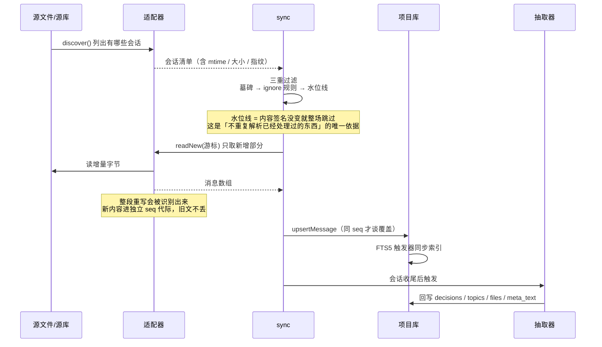

# 架构

这份文档回答三个问题：东西分成哪几块、一次会话怎么变成能检索的记忆、检索又是怎么找到它的。

---

## 一、分层

从上往下，每一层只依赖它下面那层。越界依赖（比如检索层直接读适配器）是刻意禁止的，因为那会让「哪份数据从哪来」变得说不清。

图源：[docs/diagrams/layered.mmd](./diagrams/layered.mmd)（可改后重渲染）· PPTX 同目录

两个库分工是硬边界：**项目库**只放这个项目的会话和消息，**全局库**只放跨项目的东西（经验、生命周期状态）。
分开的理由很实际——项目库会被 `forget` 整个删掉，而跨项目经验不该跟着消失。

---

## 二、一次会话怎么进来

所有源都是「磁盘上有个文件/有个库，里面按某种格式记着对话」。适配器把这堆格式差异吃掉，往上只吐一种形状。

几个不显然的决定：

**为什么用「内容签名」而不是看修改时间。** 修改时间会被备份工具、文件同步、甚至读操作碰一下。内容签名只在字节真变了时才变。

**为什么整段重写要单开一代 seq。** 源文件被重写后行号会重排，新第 3 行和旧第 3 行完全是两句话。直接覆盖等于用新内容盖掉旧正文，而且不报错。现在的做法是：重写后的内容进 `seq = 代数 × 1e6 + 行号` 的独立空间——旧文留着，新文也进来，谁都不丢。

**为什么抽取不写在采集里。** 抽取规则会变（现在已经是 v26）。采集只负责把原文搬进来，抽取是另一条可以整体重算的路径。分开的好处是改规则不用重新读一遍源文件。

---

## 三、检索怎么找

一次查询会同时走四条路，然后按归一化分数融合。不是每条路都能贡献 hit@1，这点后面会说。

图源：[docs/diagrams/retrieval.mmd](./diagrams/retrieval.mmd)（可改后重渲染）· PPTX 同目录

实测的形状很能说明问题：

| 指标 | 305 题实测 | 含义 |
|---|---|---|
| hit@1 | 11.5% | 第一下就找对的比例 |
| hit@10 | 45.6% | 前十里有正确答案的比例 |

两者差 34 个百分点，说明**能找回来，但排不对**。这是主路用 AND 的代价：查询词多一个，候选就少一截；而补充的三条路权重都低于主路，只能往队尾补。

想让 hit@1 上去，靠加同义词族没用（试过，负结果）。真正的路在查询侧——把「上次那个库一直涨的事」拆成能命中正文的词。这一步目前只做了一个很浅的版本（剔问句外壳），实测也没效果，默认关着。

---

## 四、生命周期

守护进程按各自的节奏跑 11 个阶段。不是流水线，是各自独立的定时任务——一个失败不该拖垮别的。

图源：[docs/diagrams/lifecycle.mmd](./diagrams/lifecycle.mmd)（可改后重渲染）· PPTX 同目录

`aging` 是唯一会**删正文**的阶段，所以它的判据写得最紧：只有强度低于阈值、且不在保护名单里的会话才会被归档；归档前把决策和话题的骨架留下来，正文蒸发。

有一点要说清楚：**「11 个阶段全 OK」这句话本身信息量有限**。`guard` 和 `repair` 曾经是「恒真」的——失败了只写进 note，`ok` 还是 true。现在改成了能真变红，但这句话的含金量取决于每个阶段的判据有多严，而不是那排勾。

---

## 五、想改代码从哪看

| 想做的事 | 从哪个文件进 |
|---|---|
| 支持一个新的 AI 工具 | `src/adapters/<name>/index.ts`，实现 discover / readNew 两个函数 |
| 改检索排序 | `src/search-svc/engine.ts` 的 `fusedSearch`（融合权重、长度惩罚都在那儿） |
| 改抽取规则 | `src/core/extract/`，改完记得升 `EXTRACT_VERSION`，否则存量不会重算 |
| 加生命周期阶段 | `src/core/lifecycle/stages.ts` 的 STAGES 表是唯一权威，别在别处加分支 |
| 改看板/地图投影 | `src/map/bridge.ts`（写侧口径）+ `src/cli/kanban.ts`（读回） |

一条纪律：**判据只许有一份**。同一个判断在两个地方各写一遍，迟早会漂。这个项目里踩过太多次——比如工具清单写了两份，其中一份漏了一个名字，于是白名单的完整性校验静默失效；比如 `auto:todos` 的判断，一处用模块列精确匹配、另一处用整行子串匹配，结果是人的计划被当成机器行删掉。
