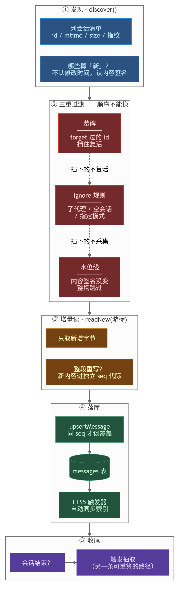

# 采集层

**读这篇你会知道**：六个源的会话文件长什么样、一轮 `sync` 按什么顺序做、源文件被重写时怎么不丢正文、以及采集坏了怎么看出来。

**什么时候该读**：`brief` 一直是空的、`doctor` 说某个源没检测到、担心重复采集或漏采。

---

## 先上手：确认采集在动

```bash
srelay status          # 会话数 / 消息数 / 最近一次采集时间
srelay sync            # 手动跑一轮，打印「发现 N · 新会话 N · 新消息 N」
srelay doctor          # 每条源的目录存不存在、能不能读
```

`sync` 输出里的数字怎么看：

| 输出 | 含义 |
|---|---|
| `发现 0` | 源目录里没有会话，或这个目录跟你当前项目无关 |
| `发现 N · 新 0` | 有会话但都采过了（水位线跳过） |
| `resumed N` | 之前中断的会话续上了 |

---

## 出问题了先看这张表

| 现象 | 大概率原因 | 怎么办 |
|---|---|---|
| `发现 0`，但我明明聊过 | 项目隔离：只采属于这个项目的会话 | 从那个项目的目录跑；或确认客户端记的 cwd 是这个项目 |
| 某个源一直「未检测到」 | 路径不对，或客户端没装 | `srelay doctor` 看具体路径；没装就是正常的 |
| 采到一半停了 | 源文件正在被写入 | 下一轮自动续；`resumed` 计数会涨 |
| 消息数涨了但搜不到内容 | 抽取代际问题 | 见 [STORE.md](./STORE.md) 的 seq 语义 |
| 会话被 `forget` 过又回来了 | 墓碑没生效 | 墓碑随库走；`forget --all` 会连墓碑一起删 |

---

采集层负责把各 AI 工具散在磁盘上的会话原样搬进项目库：发现哪些会话属于本项目、按规则筛掉不该收的、只读新增的那一段、写库、把水标记下来。它**不负责**抽取（决策/话题/摘要）、不判定会话状态（active / pending / confirmed）、不维护检索索引（FTS 触发器在存储层）、也不删任何数据。分开的理由是抽取规则会变：改规则时重算存量，不必再读一遍源文件。

入口是 [`../src/capture/sync.ts`](../src/capture/sync.ts) 的 `runSync`（:82），守护与 `srelay sync` 走的是同一份。



<sub>图源 [diagrams/capture-flow.mmd](./diagrams/capture-flow.mmd)，改完重渲染</sub>

## 一、源与各自读什么

适配器契约在 [`../src/adapters/types.ts`](../src/adapters/types.ts) 的 `SessionSourceAdapter`（:10）：`discover` / `readNew` 必选，`watchRoots` / `healthCheck` / `detectCompaction` / `changeProbe` 可选。内置源在 [`../src/adapters/registry.ts`](../src/adapters/registry.ts) 注册了六个（:157）：

| source | 读什么 | 项目归属判据 |
|---|---|---|
| `claude-code` | `~/.claude/projects/<slug>/<id>.jsonl` | 目录 slug = `pathSlug(项目根)`（claude-code/index.ts:12） |
| `zcode` | `~/.zcode/cli/db/db.sqlite`（只读连接） | `session.directory` 等于项目根（zcode/index.ts:134） |
| `codex` | `~/.codex/sessions/**/*.jsonl` + `archived_sessions/` | 首行 `session_meta.cwd`（codex/index.ts:78） |
| `qoder` | `~/.qoder-cn/cache/projects/<folder>-<hash>/conversation-history/<taskId>/*.jsonl` | 目录名 + 绝对路径摘要唯一命中，命中不到就拒绝认领（qoder/index.ts:17） |
| `trae` | `AppData/Roaming/Trae CN/User/workspaceStorage/*/state.vscdb` | `workspace.json` 里的 folder 路径（trae/index.ts:31） |
| `dsh` | `~/.dsh/sessions/<slug>/session-<uuid>/session.v4.jsonl.zstd` | slug 目录 + 头帧 `cwd`/`parentSession` 链（dsh/index.ts:2） |

两处容易踩：默认 `capture.sources` 是 `claude-code, zcode, codex, qoder, dsh`（shared/config-merge.ts:137），**不含 trae**，要用得在 `config.json` 里显式加；项目自己的适配器放 `.sessionrelay/adapters/*.js`，文件名即 source id，必须带 `id/discover/readNew`（adapters/registry.ts:103-130），读路径必须显式传项目根，漏传直接抛错（adapters/registry.ts:51）。

## 二、runSync 一轮的顺序

```
runSync                                    capture/sync.ts:82
 ├ mode=off                → 直接返回     :88
 ├ 距上次「完整」扫描 >10 分钟 → 清水位线   :64 :93
 ├ 注册表初始化（加载 .sessionrelay/adapters）:99
 ├ 载入已知会话集 :106 · ignore 规则 :109 · 墓碑 :111
 └ for 每个 source :117
      ├ adapter.discover（per-source try/catch）:134   ← 单源崩不连坐
      ├ changeProbe 取本轮内容签名          :142
      └ for 每个会话 :144
           ├ ①墓碑 :163  ②ignore :169  ③水位线 :176
           └ ingestOne（per-session try/catch）:184
                ├ getCursor → adapter.readNew（增量尾游标）:315
                ├ compaction 丢数据检测 :320
                ├ ignore 二次复查（标题取首条 user 消息）:345
                └ 事务：upsert 会话 :353 → resume 回滚 :366
                        → 逐条 upsert 消息 :390 → recordCursor :411
```

三道过滤的顺序是有讲究的：`originHint`（如 zcode 由 `task_type` 判出的工作流子代理）必须在三道 `continue` **之前**重判（capture/sync.ts:148-160），否则被 ignore 或水位线挡下的会话永远拿不到新分类——病历见该段注释（残留 33 场真值 workflow 会话 origin 仍是 auto）。

水位线的判据是「内容签名未变 **且** 会话仍在库里」（capture/sync.ts:175-180）。只看签名不看「还在库里」会出一个真缺陷：rebuild / forget / 手删行之后库与签名脱钩，重建后的库永远收不到重摄（capture/sync.ts:57-60）。签名必须由内容决定，文件型源退回 `mtimeMs:sizeBytes`——不能只用 mtime，内容变了未必动 mtime（adapters/types.ts:53）。

抽取不在这一轮里发生。采集只搬正文，抽取由两条路驱动：守护每拍 `runJudge` → `confirmSession` → `refreshExtraction`（capture/watch.ts:280，store/db.ts:735-741），以及按 `recompute.check_every_min`（默认 360 分钟，shared/config-merge.ts:145）跑的版本重算（capture/watch.ts:330-344）。因此「已入库但决策还没出来」是正常中间态，最长等到 `capture.cooldown_hours`（默认 6，shared/config-merge.ts:136）。

## 三、两种「源文件被重写」

文件型源（claude-code / codex / qoder）共用一份 tailer（[`../src/adapters/claude-code/tailer.ts`](../src/adapters/claude-code/tailer.ts) 的 `tailCompleteLines`，:65），两种重写各有一条判据：

| 形态 | 怎么识别 | 代码 |
|---|---|---|
| 变短（截断） | 文件当前大小 < 已消费 offset，`detectRewrite` 就地复位 offset 与行号 | claude-code/tailer.ts:124、claude-code/tailer.ts:79-87 |
| 变长（整段重写） | 取已消费前缀末尾 256 字节的 sha1 指纹；append-only 时不变，被重写必变 | claude-code/tailer.ts:9、claude-code/tailer.ts:26-39；调用点 claude-code/index.ts:79-88 |

两条路径都会把代数 `rewrites` 加一，随后 `seq = rewrites × 1e6 + 行号`（claude-code/index.ts:101-103，codex/index.ts:169-171，qoder/index.ts:182-184）。这样做的原因是硬约束：重写后行号重排，新第 3 行与旧第 3 行是两句不同的话，若同 seq 就撞上存储层的 `growable` 判据（只允许「旧正文是新正文前缀且变长」的覆盖，store/db.ts:1457），结果是**新正文永久写不进库**。单开一代 seq 后旧文保留、新文也进来，谁都不丢；代价是 seq 不再连续，读路径不能把它当行号用。

zcode 是 SQLite 源，走另一套：seq 取源库的 `sequence`（zcode/index.ts:257），压缩摘要放 `1e9 + time_created/1000` 的独立空间（zcode/index.ts:285）——曾用 `maxSeq+1`，实测会撞掉真实消息。

## 四、失败可见性（「容错不许静默」落在这几处）

- **三层隔离**：single-source——`discover` 抛错只跳过该源（capture/sync.ts:134-140，注释记录红队实测：一个坏源会让后面所有源一条都不采）；single-session——`ingestOne` 抛错只跳过该场，且水位线不推进（capture/sync.ts:184-189）；custom 适配器加载失败进 warnings（capture/sync.ts:99-100）。
- **warnings 谁读**：`runSync` 自己在返回前把 `SyncStats.warnings` 打到 stderr（capture/sync.ts:208-216），并按字符串跨轮去重（capture/sync.ts:250-252），去重表超 500 条整体清空（capture/sync.ts:215）——「每 15 分钟重报一条」的结局是没人看，那和静默一样糟。之所以放在 `runSync` 而不是 CLI：它同时被 CLI 与守护调用（capture/sync.ts:206）。
- **source_files.bad_lines / suspect**：由 `recordCursor` 累加，`suspect = 单轮坏行 > 50`（store/db.ts:520-537，capture/sync.ts:411-414）。⚠️ 截至本版这两列**仍无读取方**——全仓只见到写入，见「已知限制」。
- 其它被显式报出来的：compaction 估算丢 >10 条（capture/sync.ts:320-337）、同一 seq 不同内容即 `conflicts` 计数 + 人话告警（capture/sync.ts:398-405）、手动 save 命中墓碑或 ignore 直接给用户提示（capture/sync.ts:285-293）。

## 五、幂等与并发

- 幂等键是 `messages` 上的 `UNIQUE(session_id, seq_num)`（store/db.ts:68）+ `INSERT OR IGNORE`（store/db.ts:1419），所以重扫不会重复插入；游标与消息写入在同一个事务里（capture/sync.ts:352-415），崩在中途不会出现「游标过了、正文没进去」。
- 锁：项目文件锁 15 秒一拍、4 拍过期 = 60 秒（[`../src/shared/lock.ts`](../src/shared/lock.ts) 的 `LOCK_TOUCH_MS`/`LOCK_STALE_MS`，:40-41）；Windows 上另有每项目命名管道单实例锁，管道是内核对象，进程死了自动消失（capture/watch.ts:68-87）；全局守护用固定名管道（capture/watch.ts:48-53）。
- `busy_timeout`：项目库 5000ms（store/db.ts:288），只读打开 2000ms（store/db.ts:336），zcode 源库只读连接 3000ms（zcode/index.ts:23）。
- 守护每轮跑什么（capture/watch.ts:171-404）：所有写周期进同一条 promise 链串行化（:244）；`tick` 30 秒、`safety` 60 秒（:297-298）；每拍先热读配置（:257），再 `runSync` → hook 事件转 pending（:279）→ `runJudge`（:280）→ 语义补嵌（:287）；自动归档按 `archive.check_every_min`（默认 60，shared/config-merge.ts:144）跑（:304-322）；提取版本重算按 `recompute.check_every_min`（:330-344）；文件监听目录来自各适配器的 `watchRoots`（:352-367）。

## 六、实测数字

以下均来自源码注释或仓库内记录，本次改写未独立复测：

- 水位线的必要性：N 个项目守护各自监听同一批源目录，活跃时段单守护约 7.5% 单核，守护越多放大越狠（capture/sync.ts:56）。
- 10 分钟兜底清扫曾**恒不触发**：判据写反导致只要同步间隔 < 10 分钟就永远不成立，假适配器模拟 12 分钟 24 次同步，实测只读了 1 次源（capture/sync.ts:66-69）。
- zcode 签名探针代价：真实库 message 16.5 万 / part 61.5 万行，签名从 190ms 涨到 1.53s（8 倍，冷启动 7.7s），9 个项目每轮约 13.5s；改用 `PRAGMA data_version` 做粗闸后，无变化时零 SQL（zcode/index.ts:406-415）。
- 变长重写漏读：claude-code 367B → 421B 重写后 `new=0 conflicts=0 badLines=1`，游标照推到 421，库里永远是旧文本（claude-code/tailer.ts:16-18）。
- 变短重写：重写成更短 2 行后 `new=0 conflicts=1`，库内三条一字未变（claude-code/tailer.ts:59）。
- zcode 分类真值对拍（2026-10-15）：主库 zcode 源 568 场里，真值 `subagent_child`/`workflow_child` 的 382 场全部漏过标题正则，贡献 254 条决策（占全库 27%）；`task_type` 分布 subagent_child 754 / workflow_child 595 / interactive 209 / selection_side_chat 12 / fork 1（zcode/index.ts:105-113）。对拍脚本 `tools/_probe_zcode_purpose_leak.mjs` 已不在仓库里，这组数只能按注释引用，未独立复核。
- 批量写 ignore 规则：逐条版本 1000 个会话实测 1848ms，且随库增大呈平方增长（capture/ignore.ts:99-104）。
- 历史事故：ZCode 正文流式延迟导致某会话 2167 条 assistant 全部丢失，v5 迁移清空 zcode 游标后重扫补回（CHANGELOG.md:132）。

## 已知限制

- `source_files.suspect` / `bad_lines` 写进去但没有读取方，目前只能靠 `SyncStats.warnings` 那一通道看见问题。这条边界没有闭环。
- dsh 源需要 Node ≥ 24 的原生 zstd；低于该版本时 `decodeSessionFile` 直接返回空帧（dsh/format.ts:15、dsh/format.ts:51），采集静默得到 0 条——只有 `srelay doctor` 的 `healthCheck` 会说「该源暂不可用」（dsh/index.ts:287-290），而 `runSync` 不调 `healthCheck`。
- 水位线是进程内 Map（capture/sync.ts:62）：守护重启首轮全量；多进程各存一份。「10 分钟兜底清扫」只在**完整跑完发现阶段**才推进时间戳（capture/sync.ts:77-80），缺适配器的源会让它一直不推进。
- 文件型源的签名退回 `mtimeMs:sizeBytes`（capture/sync.ts:179），同毫秒同尺寸的改写识别不到；`tailHash` 只兜已消费前缀，且老游标没有该字段时跳过检查（claude-code/index.ts:79）。
- 不做源端删除同步：`source_files.deleted` 列有定义（store/db.ts:116）但没有任何读写方，源会话被删掉后库里照留。
- 不做跨源去重：同一段对话在 claude-code 与 zcode 各存一份，就是两条会话。
- trae 只能拿到用户输入历史，AI 回复加密不可读（trae/index.ts:1-4、trae/index.ts:94），所以那条源没有 assistant 侧结论。
- qoder 的「同名项目」只在摘要唯一命中时才认领，否则拒绝（qoder/index.ts:17-29）；该拒绝在真实磁盘上的触发频率未实测。
- 未实测：各源单轮解析耗时、dsh 全帧重解在本文档作者机器之外的 P50（源码注释只给了一条 15MB <100ms 的本机数字，dsh/index.ts:266）。
