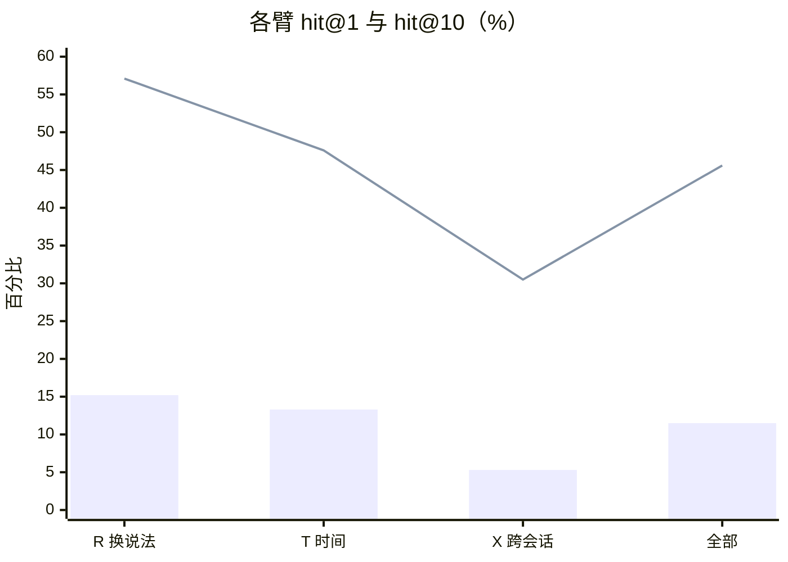

# 检索评测

一份带数字的说明，不打算好看。全套数据在 [memrelay-eval.xlsx](./eval/memrelay-eval.xlsx)，里面有柱状图和饼图可以直接改。

## 怎么测的

305 道人工造的题，落在 105 个真实会话上。每道题只有一个正确答案（那个会话），问法跟原话不一样。

三条臂的设计不一样，难度也不同：

| 臂 | 考什么 | 题数 |
|---|---|---|
| R | 换说法。同一件事，用完全不同的词问 | 105 |
| X | 跨会话。答案散在两个以上的会话里，要拼起来 | 95 |
| T | 时间相关。「上次那个」「最近那次」 | 105 |

统计上有个坑要躲开：**题不是独立的**，同一会话最多出 3 道，它们共享上下文。按题算置信区间会把区间算窄，然后你就会以为「改了 2 个点就是提升」。

所以这里用按会话整簇重采样，再配 McNemar 做配对检验。两臂比的是同一批题，比的是「A 对 B 错」和「B 对 A 错」这两个格子，跟题面难度无关。

## 结果



柱是 hit@1，线是 hit@10。两条之间的落差才是重点。

| 指标 | 值 |
|---|---|
| hit@1 | 11.5% |
| hit@10 | 45.6% |
| MRR | 20.4% |
| P50 延迟 | 388ms |

## 这组数字说明什么

**找得回来，但排不对。** 45.6% 的题正确答案进了前十，可只有 11.5% 排在第一位。中间那 34 个百分点，是排序问题，不是召回问题。

原因是结构性的：主路用 AND 匹配，查询词一多，候选就被卡掉一大截；另外三条补充路（同义词扩展、子串、标签）权重都低于主路，只能往队尾补。补得进来，顶不上去。

一个反直觉的实测：**同义词这条路试过了，没用。** 把「剔问句外壳后重搜」做出来跑了一遍（305 题 A/B），hit@1 反而差 0.3 个点，延迟还涨了 12.6%。默认关着。这件事记在这里，免得下次又有人从头试一遍。

## 弱点在哪

X 臂只有 5.3%，这是设计使然，不是 bug。它要求模型把散在多个会话里的信息拼起来，而现在的检索是按单个会话打分的，天然占不到便宜。要治它得换检索的粒度，不是调参数。

## 想自己跑

```bash
# 固定题面，避免每轮抽到不同的题
npx tsx scripts/recall-bench.ts <库路径> \
  --use-questions scripts/bench-questions-paraphrase-v2.json \
  --limit 10 --json out.json

# 两轮结果做配对比较
node scripts/bench-compare.mjs A.json B.json
```

比较脚本会同时打出**题级**和**簇级**两种区间。结论看簇级——题级那个区间是假的窄。差多少在输出里能看到，这次实测是 1.12 倍。

## 把「召回」和「排序」拆开（2026-10-19）

hit@1 / hit@10 两个数混着「根本没找到」和「找到了但排不进去」。用 `scripts/recall-oracle.ts` 在同一批 305 题上拆开（只读，不写库）：

| 指标（n=305） | 值 |
|---|---|
| 词法不可达（目标会话里没有任何查询词元） | 4.6% |
| 词法可达（OR 语义 FTS 能在目标会话命中至少一个词元） | 95.4% |
| rank 1 | 14.4% |
| rank 2–10 | 27.9% |
| rank 11–50 | 31.8% |
| > 50 / 未进前 50 | 21.3% |

**这说明瓶颈在排序，不在召回**：95.4% 的题目标会话里真的有查询词，只有 4.6% 是词法上够不着的；但可达的题里有 53.1% 被排到前 10 之外。
（本脚本的排名臂用 limit=50 以便统计 11–50 名；与 10 结果基准的 hit@1 差 1–2 个点，属旋钮/上限差异，不影响结论方向。）

**融合 A/B（同一批题面，305 题）**：

| 臂 | hit@1 | hit@10 | MRR | P50 |
|---|---|---|---|---|
| 产品默认（条件融合） | 13.1% | 39.7% | 20.0% | 337ms |
| 强制融合 `--fusion 1` | 12.1% | 40.0% | 19.7% | 359ms |
| 关融合 `--fusion 0` | 9.5% | 38.0% | 17.3% | 20ms |

结论：**强制融合没有赢过默认**（hit@1 −1.0pt、MRR −0.3pt，CI 重叠），说明「融合闸门太保守」不是主要矛盾；关掉融合反而掉 3.6pt，说明融合本身有用、只是不够强。
下一步要把力气花在排序特征（标识符/引号短语/时间锚点/任务上下文），而不是继续调融合权重。
