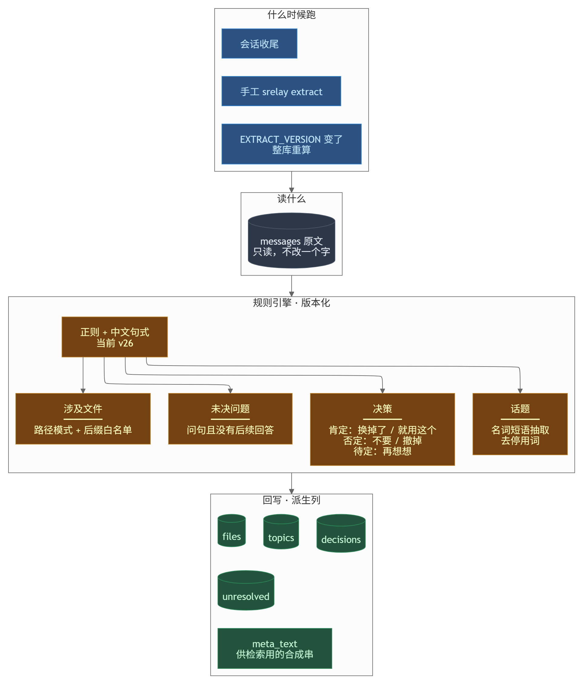

# 抽取层

**读这篇你会知道**：决策/话题/文件/未决这四样怎么从对话里抽出来、什么不算决策、改了规则怎么让存量重算、以及为什么抽错了不该手改库。

**什么时候该读**：`brief` 里出现不该出现的决策、该抽的没抽到、或者要改抽取规则。

---

## 先上手：看抽出来什么

```bash
srelay decisions        # 所有已确认决策（含出处会话）
srelay unresolved       # 未解决问题
srelay brief            # 开场简报：决策 + 未决 + 高频文件
```

改了规则之后，先用这套对比新旧差异，别直接全量重算：

```bash
srelay bench-extract --save        # 存当前抽取结果当基线
# 改规则、升 EXTRACT_VERSION
srelay bench-extract --diff latest  # 谁被剔除、谁被新增，逐个看
srelay recompute                   # 确认没问题再重算
```

---

## 出问题了先看这张表

| 现象 | 大概率原因 | 怎么办 |
|---|---|---|
| `brief` 里一条决策都没有 | 抽取版本是旧的（`doctor` 会提示「库是 v0，当前规则 v26」） | `srelay recompute` |
| 决策重复 | 去重键失效 | `srelay recompute`；仍重复就开 issue 带上样例 |
| 明显是随口附和也被当决策 | 判据太宽（见下文「什么不算决策」） | 记下原句，能补进判据 |
| 改完规则，存量没变化 | 没升 `EXTRACT_VERSION`，不触发重算 | 升版本号再 `recompute` |
| 抽出来的文件路径是错的 | 路径识别只认白名单后缀 | 见下文「涉及文件」的判据 |

---

抽取层把 `messages` 里的原始对话正文，变成会话级的派生字段：**决策**、**未决问题**、**话题**、**涉及文件**（外加代码块计数与关键往返）。全部是正则 + 结构守卫，不调用任何模型。

**不负责**：采集（`../src/capture/sync.ts`）、检索打分（`../src/search-svc/`）、简报渲染期的文本过滤（`../src/cli/brief-filter.ts` 与客户端侧的同判据副本）、经验库采集（`../src/core/extract/lesson-harvest.ts` 是另一条路，写全局库 `lessons` 草稿）。它也不写 `messages.search_text`——那是消息入库时写的派生列，规则变了要刷新得用 `srelay recompute --search-text`（`../src/bin/srelay.ts:521`）。



<sub>图源 [diagrams/extract-flow.mmd](./diagrams/extract-flow.mmd)，改完重渲染</sub>

## 数据流

```
messages(id, role, content, seq_num, created_at)
  │  sanitizeMsgs：stripInjected（<system-reminder> 等）+ stripMnemeMemory（[记忆库] 块）
  ▼
extractDecisions / extractQuestions / extractTopics / extractFiles
  │  extractForWrite：并回既有 pinned 标记
  ▼
sessions 行（decisions / key_questions / topics / files_mentioned / code_changes / summary_rule / extracted_version）
  │  metaTextOf：title + topics + 每条决策前 30 字
  ▼
meta_text（检索面，FTS 之外的另一列）
```

| 产出 | 抽取函数 | 落库位置 |
|---|---|---|
| 决策 decisions | `extractDecisions`（`../src/core/extract/extract.ts:513`） | `sessions.decisions` |
| 未决 unresolved | `extractQuestions`（同文件 `:791`） | `sessions.key_questions`（条目带 `unresolved`/`probation`/`gate`） |
| 话题 topics | `extractTopics`（`:159`） | `sessions.topics` |
| 涉及文件 files | `extractFiles`（`:75`） | `sessions.files_mentioned` |
| 代码块数 / 关键往返 | `countCodeBlocks`（`:878`）、`extractKeyExchanges`（`:1043`） | `sessions.code_changes` |
| 规则摘要 | `summaryRule`（`:1260`） | `sessions.summary_rule` |

没有独立的 decisions 表：四个产出都是 `sessions` 行上的 JSON 列（列定义见 `../src/store/db.ts:34-40`）。**提取结果的唯一入口**是 `extractForWrite`（`../src/store/db.ts:814`）；但写 `decisions`/`key_questions` 列的点有四个：confirm 的 `applyExtraction`、judge 增量 `refreshDecisionsIncremental`、版本重算 `recomputeSession`、置顶 `setDecisionPinned`（同文件 `:803-805` 记着这份名单）。因此「剥注入块」与「并回 pinned」必须锁在 `extractForWrite` / `readPinnedTexts` 一处——这两件事各漏过一次，症状都是静默（`db.ts:797-845`）。

## EXTRACT_VERSION

当前值 **26**（`../src/core/extract/version.ts:64`）。消费点不止一处：写派生列时给 `sessions.extracted_version` 打戳（`../src/store/db.ts:861`）；重算判据是 `extracted_version < EXTRACT_VERSION`（`../src/capture/recompute.ts:359`）；CLI 与 doctor 也读它做版本检查（`../src/bin/srelay.ts:459`、`../src/cli/doctor.ts:14`）。

改规则必须递增，否则存量库不会被重算——版本号就是「这批数据是哪个规则算的」的唯一标签。v3→v26 的完整变更史（每条都带实测）在 `../src/capture/recompute.ts:28-138`，`version.ts` 只放常量，避免两处各写一份。

存量重算有两条路：

- 手动 `srelay recompute`（`../src/bin/srelay.ts:449`）。**默认干跑**，只有显式 `--apply` 才写（同文件 `:487`）。
- 自动：生命周期 `extract` 阶段每 1800 秒跑一次，每批 300 个会话，循环到追平（`../src/core/lifecycle/runner.ts:277-291`）。
- 正文已删的归档会话走独立通道 `cleanArchivedDecisions`：纯文本重筛，不重抽（`../src/capture/recompute.ts:414`）。

一处口径不一致：`srelay recompute` 的帮助文本写「守护默认 6 小时才跑一批」（`../src/bin/srelay.ts:450`），而 STAGES 表里 `extract.everySec = 1800`（`../src/core/lifecycle/stages.ts:35`）。以 STAGES 表为准，帮助文本是旧数。

## 判据：什么不算决策

抽取端的目标是让垃圾**根本不入库**。逐条都在代码里（行号指向 `../src/core/extract/extract.ts`）：

| 判据 | 位置 | 挡什么 |
|---|---|---|
| 强触发词 | `DECISION_STRONG` `:182` | 决定/选择/采用/放弃/弃用…（仍需过后面所有守卫） |
| 弱触发只认句首附近 | `DECISION_WEAK_ANCHORED` `:183` | 直接用/优先用/统一用/改为使用 |
| 词中误命中 | `DECISION_FALSE_POSITIVE` `:256` | 决定论、确定性、采纳率、放弃治疗 |
| 名词化「选择X」 | `nounChoiceFalsePositive` `:286` | 选择器/选择题/选择框（后续 4 字内无变更动词才拒） |
| 转述引用 | `isQuotedSpeech` `:243` | 「助手说…」「报告提到…」这类整份粘贴 |
| 残片/表格/JSON | `plausibleDecision` `:311` | 长度 <6、冒号或竖线收尾、表格行、内嵌 JSON、闭括号开头、任意位置 `**` |
| 引号配对与极性 | `quotesBalanced` `:438` | 腰斩引文；同时放过 `user's` 这类撇号 |
| 括号极性 | `parenDepthOk` `:487` | 先闭后开 = 从括号内部截出的残片 |
| 动词后紧跟逗号 | `plausibleDecision` `:329` | 「决定，因为…」「选择，17 t/s…」 |
| 七条形状判据（代码分出 8 个拒收理由名） | `decisionShapeVeto` `:397` | open-topic / choice-open / topic-tail / report-residue / question-end / self-echo / nominal-tail / bare-fragment |

未决端是三层：候选 = 位置在后 30% ∨ 命中未决词（`:821-834`）；复核 = `wasAnswered`（问题之后 12 条 assistant、共享 ≥2 个实词才算被回答，`:655`）；残片守卫 `unresolvedFragmentReason` 现有 14 个拒收理由（空、转义换行、反引号编号、纯编号、小写英文散文、闭标点开头、开括号、代码/表格、引号不配对、括号不配对、悬空连词、去语气词 <5 字、延后空壳、ASR 机械重复，`:728`；`version.ts:47` 记的是「12 条」，代码已增至 14，这个数字漂移没登记）。此外还有观察期 7 天（`:688`）与同会话只留 1 条（`:690`、`:859-871`）。

话题与文件各有唯一判据：`isTopicNoise`（`:155`，停用词 / 纯数字 / 系统记账 token / 长度 <2）与 `isLikelyFile`（`:66`，必须「文件名 + 白名单扩展名」，先剥 URL，路径段长度也设限）。两者都同时供抽取与存量清理调用，避免「抽取说不是、清理说留着」。

**与简报端的分工**：抽取端管新数据（不产生），简报端管存量（显示时拦）。简报决策过滤器 11 条在 `../src/cli/brief-filter.ts:64-93`，第 8~11 条（问句冒充决策、口述填充词、报告残渣、`决定了`+疑问从句）与抽取端 v23/v24 的判据互补；未决段 4 条在同一文件 `:15-40`。

## 消息主键 msgId

`msgId` = `messages.id`，归一成字符串后存进每条决策/未决条目（`../src/capture/recompute.ts:241-246`）。需要它是因为 `seq` 只是位置索引：消息被归档裁剪后整体前移，按 seq 回查会**指到错的那条且不报错**（`../src/core/extract/extract.ts:11-14`）。

实测规模：857 条决策里 525 条（61%）按 seq 定位不到（`../src/core/extract/version.ts:19`）。v22 加过 msgId 字段，但两条写路径都没 `select id`，于是覆盖率实测 0%；v25 才把写路径补齐并升版本触发全库重算（`version.ts:38-46`）。出处回跳在 `../src/cli/meta.ts:24-64`：优先 msgId，缺失才回落 seq，并且**回落必须打一行统计**，不静默。rebuild 搬库时按 seq 重映射 msgId，映射不到就删字段（`../src/capture/rebuild.ts:59-78`）。

## 重算的安全性

- 只重写派生列与 `summary_rule`，不碰 `messages` 正文（`../src/capture/recompute.ts:313-323`）。
- 走 `extractForWrite`，pinned 并回（`../src/store/db.ts:814`）。
- 归档后复活的会话（`original_message_count > 0`）把骨架里没被覆盖的决策按原样补回（`../src/capture/recompute.ts:287-303`）。
- 归档清理：先整条写 `recompute_quarantine` 再删，隔离写入失败则该会话一条都不删、下轮重试；pinned 决策豁免（`:428-451`）。
- 失败行**不许**打当前版本戳：置回 0 + `extract_retry_count`/`extract_last_error` 留痕，3 次后才 park（`MAX_EXTRACT_RETRIES`，`:337-351`）。
- 以上都有单测钉住：`../test/unit/recompute-safety.spec.ts`。

## 实测数字

| 数字 | 出处 |
|---|---|
| v23 判据命中 864 条里 19 条，逐条 19/19 是垃圾 | `version.ts:22-26` |
| v24 拒收 167 条唯一（179 行），逐条判读 167/167 是垃圾、零误伤；合格 786 → 642 条唯一（97.2% → 79.4%） | `version.ts:34-37` |
| v26 未决 11 → 展示 3 + 观察 4，展示集碎片 5 → 0（123 场全量重跑） | `version.ts:50-52` |
| files 条目 10473→2934、9557→3852，人工抽 30 条判读精度 ≈93% | `extract.ts:44` |
| 单会话上限实测：12 条独立合规决策只出 10 条 | `extract.ts:502-503` |
| msgId 覆盖率（补写路径后） | **未实测**——`version.ts:20` 原文即写「这条待实测验证」 |

## 已知限制

- 归档会话正文已删，**重抽不可能**，只能纯文本重筛存量；这些条目的 msgId 永远补不上，会走 seq 回落并留痕（`version.ts:45-46`、`../src/cli/meta.ts:56`）。
- 未决观察期没有定时升级能力：一条真未决若所在会话不再新增消息、也不触发重算，会停在观察区（`extract.ts:682-685`）。
- 单会话决策上限 10 条（`extract.ts:508`）；超出的只计数写进 `summary_rule`，不入库。
- 零模型、纯形状判据。中文没有词边界，所以靠闭集关键词 + 负向后视 + 长度/结尾形态，不做语义判断（`extract.ts:361-362` 明写为什么不用分词）。
- `extractEnvFacts` / `extractCorrections` 已实现但**未接入任何写路径**，精度门禁未过（`extract.ts:890-897`）。
- 简报端第 1~7 条过滤器「刻意不接入本库的渲染路径」（`../src/cli/brief-filter.ts:58-60`），本仓内只是参照实现；注释提到的守门脚本 `tools/check-brief-filters.mjs` 在本仓不存在（`tools/` 下只有 `_probe-autoarchive-merge.mjs`），所以这 7 条目前不构成运行时保障。
- `search_text` 不在重算路径里：清洗规则改了之后，`decisions/topics` 会干净而索引仍可能陈旧，要显式 `--search-text` 才刷新（`../src/bin/srelay.ts:521-523`）。
- v26 曾因归档清理不可回滚而冻结在 25，修好 quarantine + 默认干跑后才解冻（`version.ts:56-63`）；这套闸门依赖人先跑干跑确认「会删 0 条」，自动路径本身不做这一步确认。
