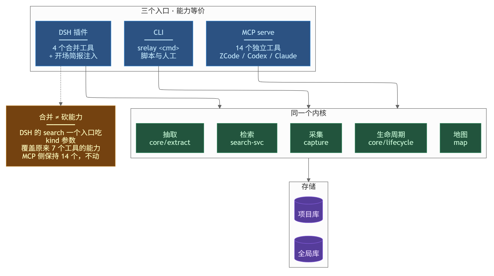

# 接口面

**读这篇你会知道**：CLI / MCP / DSH 插件 / 面板各能做什么、18 个和 4 个是什么关系、以及为什么合并入口不等于砍能力。

**什么时候该读**：想接进自己的工具、工具列表对不上、或者要改某个面的行为。

---

## 先上手：三个入口各试一次

```bash
srelay search 关键词        # CLI
srelay serve                # 起 MCP Server（stdio），给 agent 用
srelay --help               # 全部 39 个子命令
```

DSH 插件是另一条路：它注册 4 个工具，并在会话开场自动注入简报。装法见 [adapters](./adapters/README.md)。

---

## 出问题了先看这张表

| 现象 | 大概率原因 | 怎么办 |
|---|---|---|
| MCP 客户端看不到工具 | `serve` 没起，或客户端配置路径不对 | 先手跑 `srelay serve` 看有没有输出 |
| DSH 插件工具数是 4，文档写 18 | 两套不同的面：MCP 18 个，DSH 合并成 4 个 | 见下文对照表 |
| 工具名在 README 里找不到 | 文档漏更新（曾有判据假绿半年） | 开 issue；门禁现在会拦 |
| 插件改了没生效 | **改完没重新 vendor**，插件跑的是旧副本 | 重跑 vendor，再跑插件 selftest |

---

这块负责把「外面能调到什么」数清楚：把「外面能调到什么」数清楚——CLI、MCP Server、DSH 插件、面板、ZCode/Codex 接入，以及每个面**读哪份数据、写哪份数据**。不负责：排序与检索算法（见 [SEARCH.md](./SEARCH.md)）、采集与抽取内部（见 [ARCHITECTURE.md](./ARCHITECTURE.md)）。文中数字都是按源码数出来的，与 README 不一致处列在最后一节。



<sub>图源 [diagrams/interfaces.mmd](./diagrams/interfaces.mmd)</sub>

## CLI：39 个顶层子命令

注册点唯一：`src/bin/srelay.ts`。commander 自带的 `help` / `-V` 不计入。

| 命令 | 一句话 |
|---|---|
| `init` | 初始化项目并回填最近 30 天会话（`--sources` 选采集源） |
| `sync` | 一次性增量捕获 + 判定 |
| `watch` | 守护捕获（`--global` 一个进程看管注册表里全部项目） |
| `save` | 手动存储一场会话（off 模式下的唯一入口） |
| `rebuild` | 从源文件全量重建索引（旧库存为 `.bak`） |
| `maintain` | 维护：FTS 空间回收 / 孤儿文件清理 / 守护断线核算（默认干跑） |
| `forget` | 彻底遗忘：整条会话含决策从本库消失 |
| `semantic` | 语义档开关与状态（enable/disable/status/test/backfill/reembed） |
| `compress` | L3 模型压缩的干跑/落地/回滚（默认关） |
| `status` | 透明度面板：模式 / 守护 / 计数 / 拦截 / 体积 |
| `mode` | 切换捕获模式 `full` / `meta` / `off` |
| `search` | 中文全文搜索（组合过滤；`--global` 跨项目） |
| `show` | 查看会话详情（消息片段，可按 `--range`） |
| `list` | 列出会话 |
| `stats` | 本地匿名计数器（report/reset） |
| `doctor` | 环境自检与修复建议 |
| `serve` | 启动 MCP Server（stdio） |
| `scope` | 检索范围契约：show/set/add/reset/pick |
| `attach` | 挂载指定会话（本次检索只看这些） |
| `detach` | 解除挂载 |
| `export` | 导出 HOP 交接包（含 HANDOFF.md 与脱敏） |
| `import` | 导入 HOP 交接包（sha256 校验 + 归化到当前项目） |
| `team` | 贡献者统计 / 导出导入日志 |
| `decisions` | 列出已确认决策（`--kind negative` 看被否掉的路） |
| `brief` | 开场简报一次取全：决策 + 未决 + 计数 + 最近在动的文件 |
| `bench-extract` | 抽取快照与零标注 Diff 门禁 |
| `lifecycle` | 记忆生命周期（11 阶段；`--status`/`--loop`/`--only`） |
| `map` | 地图层 read/apply/declare/update/remove/check/export/import/init |
| `recompute` | 手动重算提取规则（默认干跑，`--apply` 才写） |
| `kanban` | 看板 `progress.md` 的 init/sync/graph |
| `pin` | 置顶文本含该片段的决策 |
| `unpin` | 取消置顶 |
| `unresolved` | 列出未解决问题（启发式） |
| `history` | 某文件被哪些会话讨论过 |
| `related` | 以会话为锚推荐相关历史会话 |
| `hook` | （内部）生命周期钩子入口：写 spool 事件 |
| `confirm` | 手动强制会话为 confirmed，触发提取与摘要 |
| `archive` | 归档旧会话正文 / 查看归档历史 |
| `lesson` | 全局经验层：add/list/search/maintain/export |

## MCP Server：18 个工具（11 读 + 7 写）

全部注册在 `src/mcp/server.ts`，`srelay serve` 起 stdio 服务。**读**：`srelay_search`（kind=sessions/decisions/unresolved/files 四类合一）、`srelay_show`、`list_sessions`、`get_stats`、`srelay_lessons`、`get_linked_sessions`、`suggest_related_sessions`、`srelay_handoff`（五段交接包 markdown）、`srelay_doctor`（体检；默认只读）、`srelay_market`（跨项目经验推荐）、`srelay_calibrate`（权重校准就绪度）。**写**：`set_scope`（写 scope.json + scope_log）、`annotate_session`（标签/摘要）、`save_note`（建 note 会话）、`export_handoff`（写包文件）、`import_handoff`、`release_quarantine`、`link_sessions`。

> [1020] 交接/体检/市场/校准四工具与 DSH 插件侧**同名同口径**，判据与渲染都复用 CLI 的唯一实现（`renderHandoff` / `runDoctorChecks` / `runMarket` / `feedbackStats`），MCP 层只做「取上下文 + 结构化返回」。`srelay_doctor` 默认 `fix:false`（只读），`fix:true` 也只补已安装副本，不碰库/配置/进程。

白名单 `SRELAY_MCP_TOOLS`（`server.ts:104-115`）：未设或空 = 全注册（默认行为不变，**新工具默认可见**）；设了 = 只注册列出的名字，未注册的工具连 `tools/list` 都不进，省的是**每一轮**的上下文。**全写白名单等于没设**：`want` 覆盖了 `TOOL_NAMES` 全集时函数返回 `null`，走全注册分支——这是故意的，避免「想全开却少写一个」的静默半失效（`server.ts:111-113`）。`TOOL_NAMES` 表必须与每个 `register(...)` 逐字对齐（`server.ts:124-131`），漏一个的症状不是崩，而是那条优化静默失效。只读子集另有常量 `MCP_READONLY_TOOLS`（2 个：`srelay_search`/`srelay_show`，`server.ts:99-102`），给 ZCode 这类只读客户端用。

## DSH 插件：向宿主注册 4 个工具

路径是 `integrations/dsh/index.js`（**没有** `plugins/dsh/`），给宿主注册 4 个原生工具（`index.js:753-756`）：`srelay_search`（吃 `kind`）、`srelay_show`、`srelay_remember`（记决策/置顶）、`srelay_project`（init/bind/confirm/cancel/stats）。旧工具名没消失，而是被 `legacySpec` 路由到原实现：`kind=decisions/unresolved/lessons/history|files/related` → `srelay_decisions/srelay_unresolved/srelay_lessons/srelay_history/srelay_related`（`integrations/dsh/src/tools.js:136-145`）；`remember` 按参数分派到 `srelay_record` / `srelay_pin`（`tools.js:604-606`）；`project` 的 action 映射到 5 个旧工具（`tools.js:635-645`）。`tools.js` 里仍有 16 个 `defineTool` 定义，其中 14 个是合并前的工具面，`search`/`show` 两个由新工具自己走 CLI。

**常驻进程不会自己换新代码**：插件由 DSH 宿主进程 `import` 一次（`index.js:62-63` 顶层导出 `name`/`inject`），改文件不重启宿主不生效；插件拉守护只比对 pid 与心跳，**没有版本比对**（`index.js:145-162`），所以 `npm run build` 之后仍在跑的守护继续用旧 `dist`，直到被杀。CLI 入口是三级优先（env `SRELAY_CLI_PATH` → 自带 vendor → npm 全局，`index.js:65-78`），换 CLI 同样要重启宿主。

## 面板

入口 `src/panel-entry.ts` → 构建产物 `dist/panel.js`（tsup 独立入口、`splitting:false`，见 `tsup.config.ts:33-43`）。数据全部来自 `src/panel/snapshot.ts` 的 9 个导出：`panelOverview`（总览）、`panelProjectCard`（项目卡片）、`panelLessons`、`panelLifecycle`、`watchdogOnline`、`panelCompression`（L0/L2/老化计划）、`panelConfigView`/`panelApplyConfig`（设置读/写）、`panelGraph`；另有安全校验 `assertRegisteredRoot`（`snapshot.ts:393`）与口径表 `PANEL_CRITERIA`（`snapshot.ts:48`）。数据库用 `src/panel/db.ts` 的 `node:sqlite` **只读**打开——这条链不许出现 `better-sqlite3`/`@node-rs/jieba`，否则面板插件在无原生模块的宿主里整块加载失败（`panel-entry.ts:1-10`）。设置页可改 44 个配置项（`src/panel/knobs.ts:32-112` 的 `KNOB_SPECS`）。**渲染层不在本仓库**：`src/panel-entry.ts:9` 提到的 `lib/index.js` 是插件宿主半边，仓库里没有。

## ZCode / Codex 接入

本仓库里只有**读侧**与之相关：`src/adapters/zcode/index.ts` 只读 `~/.zcode/cli/db/db.sqlite`，`src/adapters/codex/index.ts` 读 `~/.codex/sessions/**/*.jsonl` 与 `archived_sessions/`；写侧只有 `srelay hook <event>` 落 spool 文件 `.sessionrelay/events/<ts>.json`（`src/capture/hook-spool.ts:1-16`），由守护周期消费把会话转 pending。**简报注入点不在本仓库**：`integrations/dsh/index.js:50-52` 与 `brief-filters.mjs` 多处要求「与 ZCode 侧 `brief-shared.mjs` 逐字一致」，但该文件不在本仓库，ZCode 的 SessionStart hook 也不在这里——改两边时要自己去对。

## 每个面读什么、写什么

| 接口面 | 读 | 写 |
|---|---|---|
| CLI | `.sessionrelay/relay.sqlite`、`.sessionrelay/config.json`、`.sessionrelay/scope.json`、`~/.sessionrelay/global.sqlite`、`~/.sessionrelay-registry/projects.json` | 按命令：库（sync/save/archive/forget/confirm…）、config.json（mode）、scope.json + scope_log（scope/attach/detach）、导出包文件、`progress.md`（kanban）、地图 JSON（map）、spool 事件（hook）、匿名计数器（`cli/query.ts:53`，search/show 也写） |
| MCP Server | 同 CLI 的库与 scope.json | 库（7 个写工具）、scope.json + scope_log（set_scope）、导出包文件（export_handoff） |
| DSH 插件 | `relay.sqlite`（直查 SQL，只读）、`progress.md`、`~/.dsh/sessions`（项目根回落） | 绑定状态在内存（`integrations/dsh/src/state.js`）；自动建库时调 CLI `init`；起/杀守护进程 |
| 面板 | `relay.sqlite`（只读）、`config.json`、注册表、生命周期状态、语义状态文件 | `config.json`（`panelApplyConfig` → `saveConfig`） |
| adapters | ZCode 库、Codex jsonl、Claude Code jsonl、DSH 会话 | 只读（源库一律只读连接） |

## 「同一判断写了两份」的历史教训

- **工具清单**：`TOOL_NAMES` 曾漏 `srelay_lessons`，于是「全写白名单 = 全注册」这条判据对它静默失效（`test/unit/mcp-tool-names.spec.ts:9-17`）。现在防法：该测试从源码里抽 `register(...)` 名字与 `TOOL_NAMES` 静态对拍；`scripts/check-artifacts.mjs:27-38` 再从真实注册点抽名，并断言每个名字都出现在 README.md 与 user-guide.md、且不含旧计数（`count-1 工具`）。该脚本自己踩过同一个坑：旧实现找 `registerTool(` 命中 0 次，于是两段检查半年没真跑过（`check-artifacts.mjs:19-26`）。
- **简报口径**：`integrations/dsh/src/brief-sql.mjs:12-19` 把 `store/db.ts` 的 `listDecisions`/`listUnresolved` 与 `cli/meta.ts` 的排序/截断/保质期**逐条复刻**了一份，注释明写「改核心库必须同步本文件」。防法是可执行的：selftest 用 `SRELAY_BRIEF_FORCE_CLI=1` 跑对照臂，库安静时断言两路简报逐字节一致（`integrations/dsh/selftest.mjs:567`、`658`）。
- **名额常数**：简报名额 `DEC_SLOTS` 曾在三处各写一份，改两处漏第三处，症状是「SQL 路出 4 条、CLI 兜底路出 2 条」（`integrations/dsh/index.js:82-87`）。现在只留一处定义。

## 已知限制

- MCP 工具数已对齐为 **18 个（11 读 + 7 写）**：README、user-guide、ARCHITECTURE 与本文件的表述在 1020 四工具上线时一起改过（此前 README 的「7 读 + 6 写」自相矛盾，已修）。
- README 说「三个适配器（integrations/ 目录）」（`README.md:70`），实际 `integrations/` 只有 `dsh` 一个；适配器在 `src/adapters/`。
- `src/panel-entry.ts:8` 引用 `tools/check-panel-deps.mjs` 作为依赖闭包的守卫，但该文件在仓库里不存在（`tools/` 只有一个探针脚本），这条断言目前无实现。
- `src/mcp/server.ts` 里 `suggest_related_sessions` 上方的「第 14 个工具」注释在 1020 加四工具后已过期，已改成不表态序号的写法；工具顺序以 `TOOL_NAMES` 为准。
- 面板渲染层、ZCode hook 与 `brief-shared.mjs` 都不在本仓库，两侧一致性靠人守 + selftest，不靠构建。
- MCP 工具的**读/写归类**按是否改动持久状态判定；`export_handoff` 只写包文件不写库，仍计为写。
- 所有接口都假设本机单用户：没有鉴权，`serve` 是 stdio，面板 API 用注册表白名单挡路径探测（`snapshot.ts:393-410`）。
