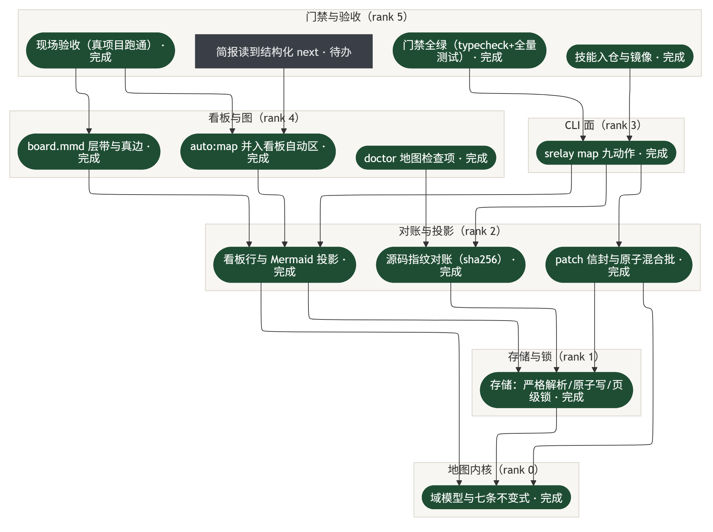

# 地图层（`srelay map`）

项目的**计划结构**存在 `.sessionrelay/map/map.json` 里：哪些事分成哪几层、谁依赖谁、每件事现在到哪一步。
它不是给人读的看板——看板（`progress.md`）是人写的流水，地图是**结构真值**。两者单向投影：地图 → 看板，不反向。

---

## 一、数据长什么样

一个项目一张默认页（页 id `map`），JSON 顶层就是四个字段：

| 字段 | 形状 | 说明 |
|---|---|---|
| `layers` | `{ id, name, rank }[]` | `rank` 越小越靠底层。边只能从高 rank 指向低 rank |
| `nodes` | `{ id, label, layer, status, detail?, evidence?, sources? }` | `id` 必须匹配 `^[a-z0-9][a-z0-9-]{0,63}$` |
| `edges` | `{ from, to, label? }[]` | `from → to` 表示 **from 用到 to** |
| `context` | `{ next?, summary?, updated? }` | 写给下一个会话的接力棒 |

状态只有五个值（`src/map/domain/types.ts:14`）：`todo` / `doing` / `blocked` / `done` / `regressed`。
同一份词表也决定看板字形与颜色，**只此一份**（`src/map/semantics/vocabulary.ts`）。

## 二、三条硬规则

1. **边必须严格跨层向下**：`rank(from) > rank(to)`。同层边、向上边一律 REFUSED。
   这条让图**天生无环**——不需要另写环检测，也不可能出现循环依赖。
2. **id 不可随意改**：id 是边的两端、也是快照与对账的键。`kb1_x` 这类带下划线的 id 会让**整批操作被拒**
   （2026-10-18 真踩过：自动同步第二轮起永久失败，因为第二批 id 拼出了非法字符）。
3. **绝不手改 JSON**：写入只走 `map apply`（1..100 条操作一次落盘 + revision 校验 + 页级锁）。
   手改轻则 revision 漂移导致后续写 CONFLICT，重则整页被拒。

## 三、写入：一次 `map apply` 发生了什么

```
读 patch（--file / stdin）
  → 逐条校验（op / 引用完整性 / 跨层不变式 / id 规则）
  → 全部通过才一次性原子替换；任一被拒 ⇒ 文件一个字节都不动
  → revision 与 --expected-revision 不符 ⇒ CONFLICT
  → 并发拿到页锁失败 ⇒ BUSY（退出码 2，值得重跑）
```

退出码三分法是刻意的：**0 成功 / 1 校验拒绝 / 2 忙**。把「被拒」和「稍后重试」混成一个码，调用方就无法决定要不要重试。
命令面九个动作（`read` / `apply` / `declare` / `update` / `remove` / `check` / `export` / `import` / `init`）的完整参数见 [map-cli.md](./map-cli.md)。

## 四、自动孵化：从看板长出第一张图

守护每轮 `sync` 会在 `runSync` 里调 `hatchMapFromKanban()`：项目有 `progress.md` 但没有地图 ⇒ 自动落一张图。
落盘用 `expectedRevision: 'absent'`——**已有地图就一个字节都不动**，所以它绝不会覆盖你手写的图。


*图源 [map-hatch.mmd](./diagrams/map-hatch.mmd)*

关键点（都在 `src/map/plan-graph.ts`，纯函数，可穷举测试）：

- **只认表头**：`readDepColumn()` 找的是表头行（`|---|---|` 分隔行的上一行）里的「依赖」。
  早先扫全文找这两个字，结果把一行**任务名叫「依赖…」**的明细列当成了依赖列。
- **片段 → 节点**：`parseDepText()` 按 `,` `，` `/` `、` `;` `|` 切；`N/A` 这类先整体判空再切（否则会被 `/` 切开）。
  `matchNodes()` 是**双向子串**：`db.ts` 能命中「db.ts 迁移」，也能命中「重写 db.ts」。
  **单字片段只认全等**——一个汉字能是任何东西的一部分，做子串全是噪声。
- **拓扑分层**：`rankByLongestPath()`，无依赖 = rank 0，其余 = 1 + max(依赖的 rank)。
- **三条纪律**：匹配不上（`unresolved`）不建边；命中多个（`ambiguous`）不建边；**绕成环整批拒绝**，绝不丢一条边凑出无环。
  两类失败都**原样报出**，不静默丢弃。
- **退化成单层**：一条边都推不出来时，图层叫「计划（自 progress.md 导入）」、0 边——
  名字刻意不写「已分层」，免得让人以为分过了。

档位（`map.hatch`，设一次永久生效）：`always`（默认，有 `progress.md` 就建）/ `complex`（人写行 ≥ `complex_min_rows` 才建）/ `manual`（从不自动建）。
`complex_min_rows` 填 0/负数/NaN 会退回默认 5——否则等于把 `complex` 悄悄降级成 `always`，设了等于没设。

## 五、增量同步：让已建好的图跟着看板长

`syncMapFromKanban()` 每轮跑一次：看板上**新增**的人写行 ⇒ 地图新增节点，落在**收件箱层**（`收件箱（progress.md 新增，未分层）`）。

五条边界（都是「宁可不同步，也不破坏你的结构」）：

| 边界 | 原因 |
|---|---|
| **只增不删** | 删除是有损动作，不该由自动路径做 |
| **只同步状态，不反推结构** | 文档明写「想让下一场看见什么，就写进地图」，从看板反推会把人的改法静默回滚 |
| **新节点进收件箱，不猜层** | 猜错层会造出假依赖；收件箱是明确的"待你分层" |
| **单轮最多 20 个** | 一次塞几百个节点等于把地图变成看板副本 |
| **`matched === 0` 整轮跳过** | 人写行是任务流水、地图节点是架构模块，两个维度。真项目上实测过 21 行对 13 节点**匹配率 0%**，同步进去就是 20 个噪音 |

## 六、对账与投影

- **对账**：节点可带 `sources: [{ path, sha256 }]`。`srelay map check` 比对源码指纹，不符 ⇒ 该节点在看板上显示「⛔ 待复验」。
  **没有 `sha256` 等于还没对过账**，不是"没问题"。
- **投影**（单向，地图永远是上游）：
  - `progress.md` 的 `auto:map` 行（人写行一个字都不动）
  - `.sessionrelay/board/board.mmd`（层带 + 真边，给看板图用）
  - `.sessionrelay/map/brief.txt`（一行简报：`🗺 地图：N 节点 / M 边` + 下一步 + 待复验数 + 陈旧提醒 + 门禁状态）

投影是幂等的：看板行没变 ⇒ 图不重写。所以「图一直那样」通常不是漏刷新，而是**地图本身没被改**。

## 七、真实数据（8 个项目，2026-10-18 实测）

| 项目 | 节点 | 边 | 层 | 来源 |
|---|---|---|---|---|
| `E:/小说项目` | 69 | **21** | 5 | 自动孵化（依赖列可解析） |
| `D:/dsh插件  记忆` | 53 | 0 | 1 | 自动孵化（依赖列是环境前置条件，推不出任务依赖） |
| `E:/music player` | 40 | 0 | 1 | 自动孵化 |
| `D:/agent1super` | 13 | **17** | 6 | **人写的**结构图 |
| `E:/mc整合包` | 10 | 0 | 1 | 自动孵化 |
| `D:/逆向` / `D:/测试` / `E:/work` | 7 / 3 / 1 | 0 | 1 | 自动孵化 |

合计 **196 节点 / 38 边**，其中**只有 2 个项目长出了边**。这不是缺陷，是数据现实：绝大多数 `progress.md` 根本没有依赖列，
或者那一列写的是「Node≥22」「pi 0.86.1」这类**环境前置条件**——那是"跑起来需要什么"，不是"这件事依赖哪件事"，硬连成边就是假边。

下面这张是 `D:/agent1super` 的真实地图（13 节点 / 6 层 / 17 条边），颜色是状态：



*图源 [map-real.mmd](./diagrams/map-real.mmd)，由内核 `renderMapMermaid(root, [])` 直接导出（只传空的人写行，看地图本身）*

## 八、已知限制

- **只有依赖列能长出边。** 代码耦合、会话句式这些线索都试过或评估过：它们能证明"两个文件常一起改"，
  推不出"两个任务谁先谁后"，更定不了方向。没有第三条路。
- **单层图建不了边。** 边必须跨层向下，所以「先建边再分层」的顺序是错的；必须先拓扑分层。
- **`matched === 0` 的项目永远不会自动新增节点。** 手写结构图（节点是架构模块、看板是任务流水）就属于这一类，
  它只同步状态、不增长节点。这是有意为之。
- **`renderMapMermaid` 的人写行参数是调用方给的。** 「地图本身」和「看板全图」是两个视图；
  本文件里的图是前者。
- 地图响应 **`map check`** 的对账，但不做「自动修」：源码变了只是打「待复验」，改不改由人决定。
